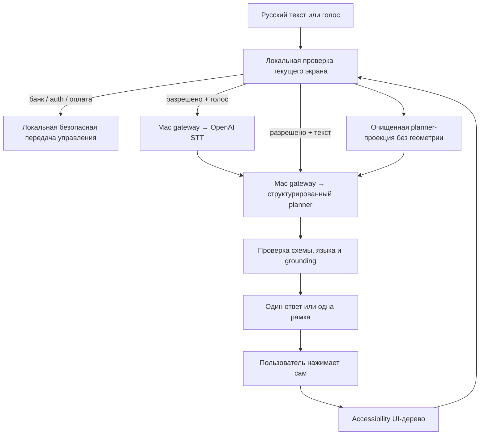

# Опора

Android-проводник, который читает доступное UI-дерево текущего приложения,
объясняет следующий шаг и подсвечивает один реально найденный элемент. «Опора»
не нажимает кнопки и не вводит данные за пользователя.

Android-проект находится в [`src/ScreenSaathi/`](src/ScreenSaathi/). Старое
внутреннее имя `ScreenSaathi` и имена классов пока сохранены, чтобы не расширять
рискованный рефакторинг перед MVP.

## Что уже работает

- Русский текстовый и голосовой запрос проходят через один сценарный цикл.
- Текущий экран читается только через Android Accessibility API; скриншоты не
  снимаются и vision fallback отсутствует.
- Планировщик возвращает один структурированный шаг или краткий ответ.
- Цель шага повторно разрешается в том же UI-дереве; при неоднозначности рамка
  не показывается.
- После самостоятельного нажатия пользователя старый highlight удаляется,
  новый экран читается заново, и исходная цель продолжается.
- Известные банковские приложения, авторизация, платёжные данные и финальные
  действия останавливаются локально до записи голоса и сетевого планировщика.
- Звонок разрешён только одному локально настроенному контакту после явного
  одноразового подтверждения.

Сценарий заказа такси в Яндекс Go вручную пройден пользователем на реальном
Samsung 18 октября 2026 года. В production-коде нет последовательности экранов
Яндекс Go: это проверка общего механизма по UI-дереву.

## Как устроен текущий MVP



При сетевой ошибке приложение показывает ограниченное локальное восстановление
или приостанавливает сценарий. Старый `StepEngine` остаётся в репозитории для
legacy-тестов, но не является fallback универсального MVP-сценария.

Подробности: [архитектура](src/ScreenSaathi/docs/ARCHITECTURE.md),
[проверочные сценарии](src/ScreenSaathi/docs/DEMO.md) и
[зафиксированный MVP](src/ScreenSaathi/docs/OPORA_MVP.md).

## Разработка и запуск на телефоне

Нужны Android SDK, физический Android 8.0+ и Mac-шлюз для текущего OpenAI
прототипа. API-ключ хранится на Mac и не компилируется в APK.

```bash
cd src/ScreenSaathi
./gradlew testDebugUnitTest assembleDebug
python3 scripts/openai_proxy.py
adb -s <serial> reverse tcp:8787 tcp:8787
adb -s <serial> install -r app/build/outputs/apk/debug/app-debug.apk
```

Для сетевых вызовов телефона используется USB reverse, а исходящие запросы
шлюза идут через VPN Mac. Точный порядок и диагностика описаны в
[`src/ScreenSaathi/docs/DEVELOPMENT.md`](src/ScreenSaathi/docs/DEVELOPMENT.md).

После переустановки Android может отвязать Accessibility Service: если рамка
не появляется, выключите и снова включите службу в системных настройках.

## Данные и безопасность

Телефон обращается к локальному Mac-шлюзу, а не напрямую к OpenAI. Шлюз
пересылает в OpenAI голосовой WAV для STT, очищенное текстовое представление
доступного UI-дерева для planner и русскую инструкцию для TTS.

Входной и синтезированный WAV — временные cache-файлы и удаляются после
использования. Полный журнал распознаваний и UI-деревья не сохраняются.
Для восстановления безопасной сессии может сохраняться одна минимальная
зашифрованная капсула до 30 минут; её поле `goal` содержит текущую просьбу и,
если просьба была голосовой, распознанный текст этой просьбы.

Полное описание: [`src/ScreenSaathi/docs/DATA_HANDLING.md`](src/ScreenSaathi/docs/DATA_HANDLING.md)
и [`src/ScreenSaathi/SECURITY.md`](src/ScreenSaathi/SECURITY.md).

## Границы пилота

- Публикацию и оформление в RuStore владелец продукта выполняет отдельно.
- Переход пилотной сборки с текущего OpenAI-прототипа на DeepSeek и Yandex Kit
  вынесен в следующий этап.
- Приложения с пустым или неполным Accessibility-деревом не поддерживаются:
  «Опора» сообщает об ограничении, а не угадывает по пикселям.
- Микрофон, overlay, Accessibility и речь требуют совместной проверки на
  физических устройствах; unit-тесты не заменяют device/e2e-приёмку.

См. [`ROADMAP.md`](ROADMAP.md) для разделения сделанного и отложенного.

## Лицензия

[MIT](LICENSE).
