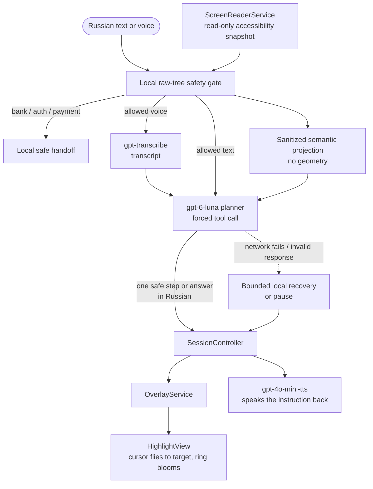

# Опора

### Android-проводник, который читает UI-дерево и показывает, куда нажать


[](https://github.com/NITISH-R-G/ScreenSaathi/actions/workflows/android.yml)
[](LICENSE)
[](https://kotlinlang.org)
[](app/build.gradle.kts)
[](https://github.com/NITISH-R-G/ScreenSaathi/releases/latest)

Most voice assistants answer questions or launch apps. ScreenSaathi reads the
**live UI through Android's Accessibility API**, resolves the *actual* button
or field you need — not a hardcoded coordinate — and draws a ring around it.
Then it waits for **you** to tap it. It never acts on your behalf.

The current MVP has one deliberately narrow user-facing language: Russian.
Both typed and spoken goals are answered in Russian.

## 🚀 Try it now

No build, no Android Studio — just a phone.

1. **[Download the latest APK](https://github.com/NITISH-R-G/ScreenSaathi/releases/latest)** from the Releases page.
2. Open the downloaded file and tap **Install** (allow "install from unknown sources" if asked — this is normal for an APK not on the Play Store).
3. Open **ScreenSaathi** and tap **1. Allow display over other apps** → enable it for ScreenSaathi.
4. Tap **2. Allow microphone** → grant it.
5. Tap **3. Turn on ScreenSaathi screen reader** → find ScreenSaathi in the Accessibility list → enable it.
6. Back in the app, tap **Start assistant**. A small floating pill appears.
7. Go to the home screen, open any app, tap the pill, and speak a request — e.g. *"Help me book a taxi."* Watch it ring the real button for you to tap.

A **physical Android device (8.0+)** is required — accessibility services,
overlay windows and the microphone don't behave meaningfully on an emulator.
Building from source instead? See [Build](#build) below.

## What it looks like

The images below document the overlay UI. They are not inputs to the assistant:
the runtime neither captures nor sends screenshots.

| | |
|---|---|
|  |  |
| Idle — waiting for a request | Listening — the waveform is real mic amplitude, not decorative |
|  |  |
| Screen understanding + target highlighting — the ring sits on Uber's actual `Where to?` element, resolved from the live accessibility tree, not a hardcoded coordinate | Keyboard-aware — the overlay detects the IME and moves itself clear automatically |

## How it works

```
Voice  →  Intent (OpenAI STT + planner)  →  Screen perception (Accessibility API)
       →  Target resolution (ranked, app-agnostic)  →  Visual highlight
       →  User taps it themselves  →  Screen-change detected  →  re-perceive  →  repeat
```

Full breakdown: [`docs/ARCHITECTURE.md`](docs/ARCHITECTURE.md). The *why*
behind the less obvious choices: [`docs/DECISIONS.md`](docs/DECISIONS.md).

Built solo in a single hackathon push — see [Honest limitations](#honest-limitations-read-this-before-you-get-excited)
before you assume more than what's demonstrated above.

## Architecture



Five pieces, and only five — this is a deliberate freeze, not an oversight:

| Piece | File | Job |
| --- | --- | --- |
| Overlay pill | `OverlayService.kt`, `overlay/HighlightView.kt` | Renders an `OverlayCommand`. Never reasons. |
| Screen reader | `ScreenReaderService.kt`, `screen/ScreenSnapshot.kt` | Read-only accessibility snapshot. No gestures. |
| OpenAI STT | voice transport + recorder | `gpt-transcribe`: 16 kHz mono WAV → transcript. |
| OpenAI planner | guidance planner | `gpt-6-luna`: strict structured response → one safe step or answer. |
| OpenAI TTS | speech transport + player | `gpt-4o-mini-tts`: Russian instruction → WAV audio (`marin`). |

`session/SessionController.kt` orchestrates them. If a network call fails or a
response cannot be grounded, the universal MVP session uses bounded local
recovery or pauses instead of inventing a step. The legacy `StepEngine` remains
for old rehearsal paths and tests; it is not the fallback for open-ended MVP
guidance.

This diagram is the **M1 milestone** shape — frozen at the time, no field ever
removed from a contract in `contracts/`. Real subsystems added since (target
resolution, the movable/keyboard-aware overlay, the voice waveform, the
launcher) are documented in [`docs/ARCHITECTURE.md`](docs/ARCHITECTURE.md),
the current source of truth. See `docs/PARKING_LOT.md` for what's still
deliberately deferred, and `CONTRIBUTING.md` before proposing anything that
touches a core piece.

## Build

Building from source instead of using the release APK? Full walkthrough in
[`docs/DEVELOPMENT.md`](docs/DEVELOPMENT.md). Short version:

Create `local.properties` in the project root (it is gitignored):

```properties
sdk.dir=C\:/path/to/Android/Sdk
openai.api.key=sk-your-key-here
```

The key is read only by the localhost development gateway and is never
compiled into the APK. To test live AI on a USB-connected phone, run
`python3 scripts/openai_proxy.py` and `adb reverse tcp:8787 tcp:8787`. See
[`docs/DEVELOPMENT.md`](docs/DEVELOPMENT.md) for the exact flow.

```bash
./gradlew assembleDebug
./gradlew testDebugUnitTest
```

## Contracts (frozen at M1)

`contracts/` holds the four JSON Schemas that everything else is written
against: `planner`, `task`, `accessibility`, `overlay`. No field is ever
removed after M1 — only optional fields may be added.

Tasks are pure data: `app/src/main/assets/tasks/*.json`. Two exist today —
`pay_bill` (the original demo screen, resource-id driven) and `book_taxi`
(a real installed ride app, matched by visible text since third-party view
ids are obfuscated — see `task/RideApps.kt`). Adding a task is dropping a
JSON file here, not writing code.

## Running the demo

1. Launch the app, grant **display over other apps**, **microphone**, and
   enable the **ScreenSaathi screen reader** in Accessibility settings.
2. Tap **Start** — the pill appears at the bottom edge.
3. Open the target app. For example, open Yandex Go and ask in Russian to
   order a taxi; the same generic loop works for any readable UI tree.
4. Tap the pill to expand, tap the mic, say what you want to do, tap the mic
   again. The cursor flies to the field; the instruction is spoken back in
   Russian.

Long-press the pill to reveal the debug panel (transcript, intent, step,
target, latency, confidence, detected language). Keep it hidden during a real
demo.

> **Demo-day landmine:** `adb install` or force-stop silently unbinds the
> accessibility service. The app keeps working but the highlight stops
> resolving. After any reinstall, toggle the screen reader off and on in
> Settings. See `docs/PARKING_LOT.md`.

## Data handling

`ScreenReaderService` reads the accessible UI tree of the foreground app. The
phone sends voice, sanitized tree text and spoken instructions to the local Mac
gateway; the gateway forwards the corresponding requests to OpenAI. Temporary
WAV files are deleted after use. Full transcript logs and UI trees are not
persisted, but a short-lived encrypted resume capsule stores the active goal;
for a voice goal, that field is the recognized request text.
Full accounting: [`SECURITY.md`](SECURITY.md) and
[`docs/DATA_HANDLING.md`](docs/DATA_HANDLING.md).

## Honest limitations (read this before you get excited)

This was built solo in a single push and has real, known gaps — recorded here
rather than discovered by you later:

- **It narrates, it doesn't automate.** The user still types the amount,
  still types the destination — this points and reads aloud, it does not
  fill in a field for you.
- **Planner and TTS latency are both over their own stated budgets**
  (planner 867–1481 ms against a 700 ms target, TTS 909–1462 ms against
  900 ms) — see `docs/PARKING_LOT.md` for the numbers and why the visual
  cursor lands before speech regardless.
- **Some third-party apps expose little or no useful accessibility tree.**
  The assistant reports that limitation instead of capturing pixels or
  guessing from the visible layout.
- **The OpenAI path needs continued physical-device Russian QA.** Unit
  tests cover the deterministic and parser code, but microphone, accessibility,
  overlay, and spoken output must be checked together on a real Android phone.

## Contributing

Bug reports, PRs and questions are welcome. If you're looking for a place to
start, [`CONTRIBUTING.md`](CONTRIBUTING.md) has a "Good first contribution"
section broken down by area (AI/agent, Android, vision/perception, UX,
safety, developer experience). See [`ROADMAP.md`](../../ROADMAP.md) for what's
shipped, in progress, and planned — and [`AGENTS.md`](AGENTS.md) if you're an
AI coding agent picking this up.
